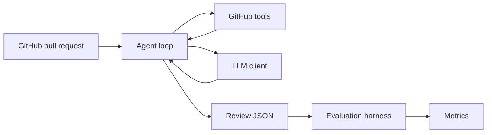

# CodeReviewBot

CodeReviewBot is a Python agent that reviews GitHub pull requests, gathers relevant code through tools, and produces structured review comments; its quality will be evaluated on public benchmarks.

Work in progress. Built with AI assistance.

## Architecture



## Run locally

In Windows PowerShell, create and activate a virtual environment, then install the project and development tools:

```powershell
python -m venv .venv
.\.venv\Scripts\Activate.ps1
python -m pip install --upgrade pip
pip install -e ".[dev]"
pytest -v
```

Run a pull request review with `python -m codereviewbot.cli owner/repo 123`. Comments are dry-run by default; use `--post-comments` to enable posting. Run an evaluation with `python -m codereviewbot.eval.cli --cases data/cases.jsonl --out results/run1`.

## Results
